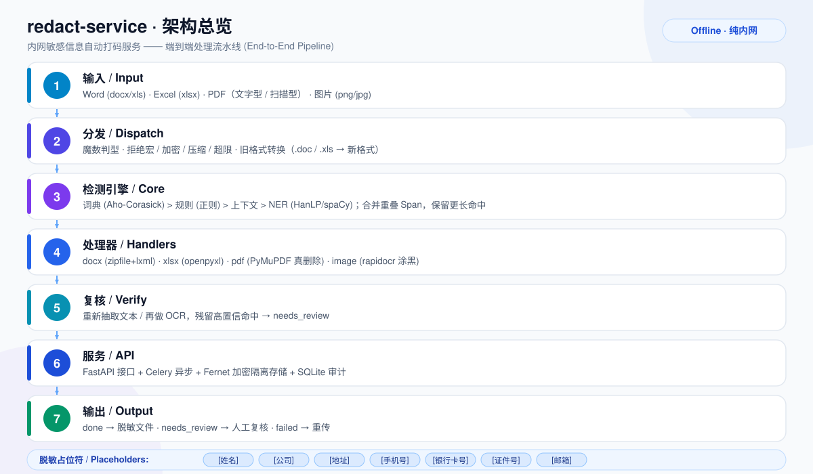

<div align="center">
  
</div>

# redact-service

[](https://www.python.org/)
[](https://fastapi.tiangolo.com/)
[](https://docs.celeryq.dev/)
[](docker-compose.yml)
[](tests/)
[](reports/eval.md)
[](#)
[](#)
[](LICENSE)

纯内网、不上云的上传敏感信息自动打码服务。中英文；支持 Word / Excel / PDF / 图片。
设计为独立 Python 服务，主项目通过 HTTP 调用。

## 架构



## 目录

```
redact-service/
  config.yaml          # 全部配置（路径/阈值/占位符）
  requirements.txt
  BLOCKERS.md
  core/       span.py config.py detect.py rules.py ctx.py dict_match.py ner.py
  handlers/   base.py ocr.py media.py docx_h.py xlsx_h.py pdf_h.py image_h.py dispatch.py verify.py
  api/        main.py tasks.py storage.py audit.py
  tools/      gen_testdata.py evaluate.py integration_client.py
  tests/      test_detect.py test_api.py
  dicts/      customers.txt        # 客户词典（主项目导出）
  testdata/   reports/             # 测试数据与评测报告
  Dockerfile  docker-compose.yml
```

## 快速开始（开发，单机同步模式）

```bash
pip install -r requirements.txt
python tools/gen_testdata.py          # 生成 100 份测试文件与 labels
python tools/evaluate.py              # 评测，输出 reports/eval.md
python -m pytest tests/ -q            # 单元 + 接口测试
uvicorn api.main:app --port 8080      # 启动服务
```

`config.yaml` 中 `service.sync_mode: true` 为进程内同步处理；生产用 Celery 时设为
`false`（或环境变量 `REDACT_SYNC_MODE=false`）。

## 接口（T3.1）

- `POST /v1/redact`  表单字段 `file` -> `{task_id, status}`
- `GET  /v1/tasks/{id}` -> `{status, kind, counts, warnings}`
  状态：`queued | processing | done | needs_review | failed`
- `GET  /v1/tasks/{id}/result`  仅 `done` 返回脱敏文件（其余返回 409）
- `GET  /v1/reviews`  待人工处理（needs_review / failed）列表
- `GET  /healthz`

curl 示例：

```bash
TID=$(curl -s -F file=@sample.docx http://127.0.0.1:8080/v1/redact | jq -r .task_id)
curl -s http://127.0.0.1:8080/v1/tasks/$TID
curl -s -o clean.docx http://127.0.0.1:8080/v1/tasks/$TID/result
```

## 主项目接入（T3.5）

上传入口改为：上传 -> `/v1/redact` -> 轮询任务 -> 仅 `done` 的文件进入业务流程。
`needs_review` 进待人工处理列表，`failed` 提示重传。参考 `tools/integration_client.py`。

## 离线依赖（T0.2）

1. 联网机器：
   ```bash
   pip download -r requirements.txt -d wheels/
   # 轻量视觉模型 rapidocr 的 ONNX 模型随包分发；
   # HanLP MSRA NER + 分词模型、spaCy en_core_web_sm 见下
   ```
2. HanLP 模型（内置下载器在部分网络下会报 size mismatch，直接下载 zip 即可）：
   - `https://file.hankcs.com/hanlp/ner/msra_ner_electra_small_20220215_205503.zip`
     -> `%APPDATA%\\hanlp\\ner\\`（Linux：`~/.hanlp/ner/`）
   - `https://file.hankcs.com/hanlp/tok/coarse_electra_small_20220616_012050.zip`
     -> `%APPDATA%\\hanlp\\tok\\`（Linux：`~/.hanlp/tok/`）
3. spaCy 模型：`en_core_web_sm-3.x-py3-none-any.whl` 放入 `wheels/` 后离线安装。
4. 内网安装：`pip install --no-index --find-links wheels/ -r requirements.txt`
5. 设置 `HANLP_HOME`（可选），`REDACT_CONFIG` 指向配置。

## 部署（T5）

```bash
echo "REDACT_KEY=$(python -c "from cryptography.fernet import Fernet;print(Fernet.generate_key().decode())")" > .env
docker compose up -d --build
```

- `api`：FastAPI；`worker`：Celery（并发=CPU 一半，内存上限 4g 可调）；`redis`：队列。
- 单文件上限 50MB；CPU 可跑，GPU 非必须。
- 密钥仅来自环境变量 `REDACT_KEY`，不进入代码库。
- 原件隔离在 `/data/quarantine`（Fernet 加密），脱敏结果在 `/data/clean`。
- 日志轮转由 compose `logging` 配置（10MB × 5）。

## 模型 / 词典热更新（T5.3）

- 词典：编辑 `dicts/customers.txt`（`词<TAB>类型`，类型 PERSON/ORG/ADDRESS），
  服务会按文件修改时间自动热加载（`dict_match` 监测 mtime），无需重启。
- 模型：拷入新模型文件到挂载目录 -> 重启 `api`/`worker` 容器 -> 重跑
  `python tools/evaluate.py` 确认指标不下降。

## 设计要点

- 检测顺序与优先级：词典(0.95) > 规则(0.9) > 上下文(0.85) > NER(0.6)；
  重叠时保留更长 Span。
- 复核（T2.7）只用高置信来源（规则/词典/上下文）；NER 在"标签:占位符"文本上
  噪声大，不计入残留判定（详见 `handlers/verify.py` 注释）。
- 真删除：PDF 用 `apply_redactions`；图片命中片段涂实心黑；docx/xlsx 直接改文本。
- 拒绝：含宏文档、加密文件、压缩包、>50MB、>200 页；损坏文件返回 failed。

## 可选：本地小模型复核（T6，未启用）

阶段 4 已在合成集达标（各类型召回 100%，verify 通过率 100%），故未引入本地 LLM。
如需在真实样本上进一步降误报/漏报，可按清单用 vLLM/llama.cpp 部署 Qwen 小模型，
仅对"NER 低分命中"和"verify 疑似遗漏"片段二判，提示词要求只输出 JSON 敏感片段列表，
原文不得离开内网。

## 许可证

本项目以 [Apache License 2.0](LICENSE) 发布，版权归 2026 liao96312 所有。
第三方依赖及其许可见 [NOTICE](NOTICE)。

